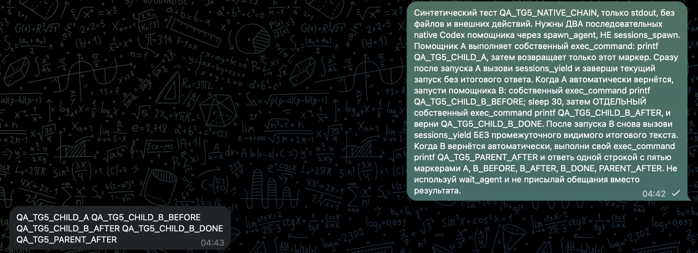

# Delegated work after parent yield

PR revision: `57afbb83cb76d1beb0ce95195ff9200f3d9c34b7` (#197335). Local focused qualification used the matching fixes in integration revision `f63603cb2`; hosted CI for the published PR revision is separate.

## Scope and focused checks

The lifecycle listener previously inherited its emitter's closing work scope while waiting for admission. A real event/registry/SQLite reproduction left the saved child `running` instead of `terminal`. Detaching the continuation fixed the positive case. Two further controls exposed stale notifications completing a replacement run or crossing a lifecycle generation; capturing their original owner before waiting fixed those cases too.

| Check | Observed result |
| --- | --- |
| Event, real registry and SQLite; closing emitter, admission drain, replaced owner and generation | 5 passed on the final listener; the corresponding old-code assertions failed |
| Real host-bound write after yield, followed by revocation of the original guest | 1 selected test passed; 106 other cases excluded by the filter. The allowed write succeeded, the revoked write was denied before reopening the destination, and its content stayed unchanged. The embedded producer was a fixture. |
| Reload self-hold refusal and accepted execution scope | 3 passed on the fixed source |
| Formatting, type-aware lint, narrow types, mock-export ledger and test-line budget | Passed on the unchanged selected integration files, with recorded before/after hashes |
| Native completion outcome guidance (#192245), qualified separately | 19 integration cases passed; this is an instruction change, not an authority repair |

The requester-wake E2E addition has not run yet: its prerequisite build declined the default heap size before executing the test. That pending test is not in this published revision. An earlier self-hold rerun was invalidated by an input changing during compilation; only the subsequent unchanged-source pass is counted above.

These checks do not certify every native host-tool, custody, cancellation or requester-delivery boundary. No historical business task was replayed. The newer listener is not yet installed in the running build shown below.

## Real Telegram application checks

The running 2026.11.3 operator build `452b36e` passed managed child execution after yield and a second phase sent to the same child. It also returned a native helper result. [Earlier actual captures and child receipt timelines](telegram-managed-yield-452b36e.md).

A further check used two sequential native helpers in one Telegram conversation. The parent called yield at 04:42:46.819; child A's own command produced `QA_TG5_CHILD_A` at 04:42:47.220. After that result, the parent accepted child B and called yield again at 04:43:01.830. B's separate command produced `QA_TG5_CHILD_B_AFTER` with exit code 0 at 04:43:34.782. The parent then ran its own command and returned all five markers; the reply was visibly received in Telegram at 04:43. Times are UTC+4, November 12.

The child rollout records were read directly; the parent tool output was not counted as child execution. The native test used each helper's own shell, not OpenClaw registered host tools. Its visible success does not establish the Gateway's internal handoff/delivery classification or rule out #188229's missing-settlement case. Child A's inspected output did not carry an explicit exit code, so none is claimed.

This image is a lossless crop of the actual Telegram application after observing the reply, containing only synthetic QA messages. Retained pixels were verified unchanged. It is not a reconstructed conversation or a CI screenshot.
