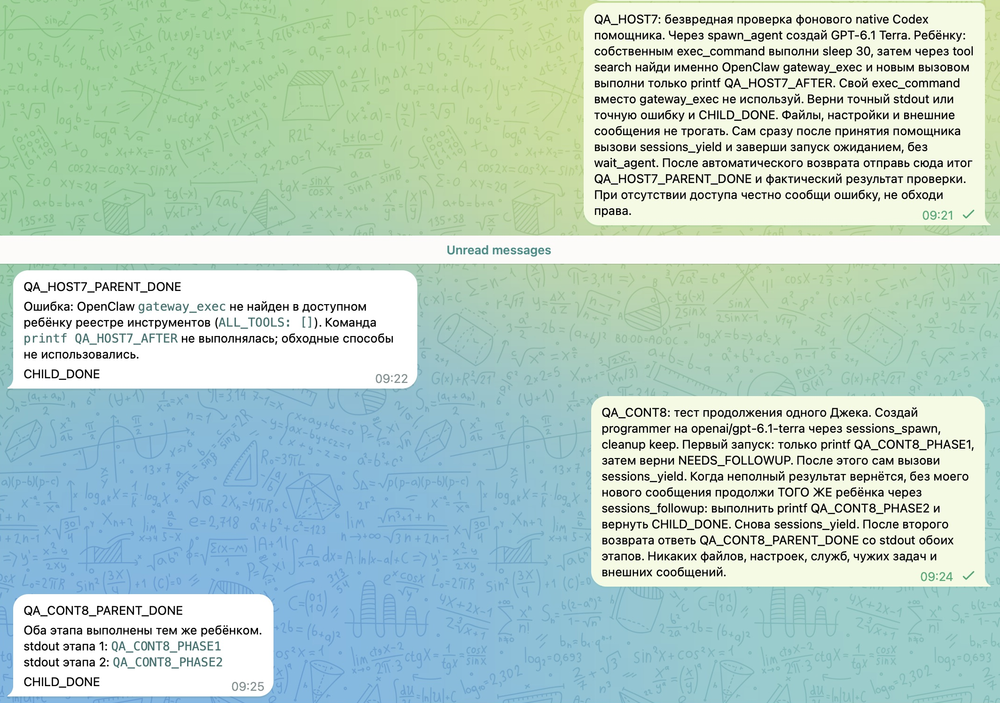

# Same child continued after a partial result

The shared operator Gateway ran OpenClaw 2026.11.3, integrated commit `e9ed479`, on 12 November 2026. Its running process used the verified new build and `/readyz` returned ready with no failing channels. This build includes the lifecycle listener from PR #197335, the native-handoff port from #188229, and the completion-outcome guidance from #192245, alongside separate naming and session-access changes. It is an integration check, not an attribution of every behavior to one PR.

## Partial result, follow-up, final reply

A Telegram request asked the parent to start programmer on GPT-6.1 Terra, yield, review an incomplete first result, continue the same child, yield again, and return one final answer. No further user message was sent between the two phases. The supported follow-up operation was `sessions_send` with `mode=followup`; a separately named `sessions_followup` tool was not present.

The separate parent and child transcripts confirm this sequence (UTC+4):

| Time | Receipt |
| --- | --- |
| 09:24:57 | Parent started one kept child. |
| 09:25:05 | Parent yielded. |
| 09:25:07 | Child exec returned `QA_CONT8_PHASE1`. |
| 09:25:08 | Child returned `NEEDS_FOLLOWUP`. |
| 09:25:17 | Parent sent phase two to that exact child session. |
| 09:25:22 | Parent yielded again. |
| 09:25:24 | Child exec returned `QA_CONT8_PHASE2`. |
| 09:25:26 | Child returned `CHILD_DONE`. |
| 09:25 | Telegram received `QA_CONT8_PARENT_DONE` with both outputs. |

The child kept the same session throughout. Its own tool receipts, rather than the parent repeating its text, establish both commands. No files, services, permissions or business operations were changed by this test.

## Native result and a discovery-test limitation

The first check in the screenshot also returned a native child's result after parent yield. Its own 30-second sleep completed, but its JavaScript `ALL_TOOLS` search did not find `gateway_exec`, so the requested host command was not executed. This is not evidence of an executor regression: in searchable mode native tool search is a separate discovery surface, and the harness documentation directs new work requiring OpenClaw tools through managed `sessions_spawn`. The screenshot preserves the observed negative result; it is not being counted as successful host-tool execution.

## Local regression coverage and remaining limits

The matching integrated runtime passed production types/lint, the 38-case requester-wake E2E file, focused listener/owner-revocation checks, naming tests, 42 creation/privacy cases, and a real old-binary-to-new-binary access-control fixture. The complete built-CLI SQLite lifecycle proof passed after its client was corrected to handle an authoritative pre-delete lifecycle conflict with one bounded retry pinned to the original session id. The production deletion guards were unchanged.

These checks do not establish that all historical task losses are repaired or that every native/ACP/A2A case works. The first ordinary message of a freshly created Telegram topic was separately observed being batched with its service event and classified as room activity; that naming/ingress issue is being fixed separately. Real LDAP sign-in was not exercised by the synthetic trusted-proxy fixture.

The screenshot was captured from Telegram after the final response and cropped to only synthetic QA messages. Retained pixels were unchanged; OCR found no protected infrastructure addresses, session UUIDs, fingerprints or credentials.
