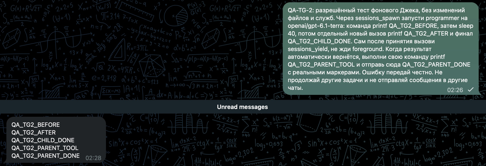
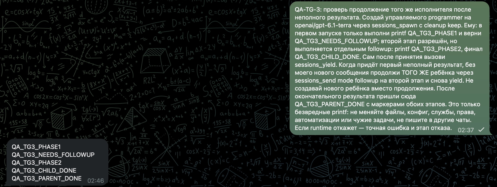
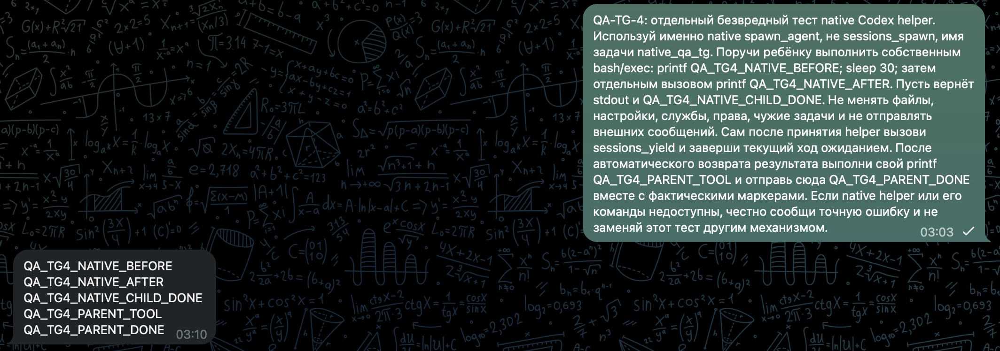

# Delegated work returned to Telegram after yield

Tested November 12, 2026 on OpenClaw 2026.11.3 operator build `452b36e0710437b66ddcc9723098d0c6da9b80bd`. Times below are UTC+4. These were harmless `printf` tests in a private Telegram bot topic, with a managed programmer child using GPT-6.1 Terra. They did not repeat any business operation.

## Commands after the parent yielded

The parent yielded at 02:26:56.866. The child's own history records a running command with a 40-second wait, its successful process exit at 02:27:37.226, and a separate command at 02:27:38.824 that returned the AFTER marker at 02:27:40.509. The child completed at 02:27:42.453.

The parent woke automatically, ran its own command successfully at 02:28:05.902, and produced the final reply at 02:28:08.318. The actual Telegram UI showed all five requested markers in the received reply. Child and parent tool receipts were checked separately; wrapper projections were not counted as duplicate executions.

## Continuing the same child

A second test deliberately split the work into two runs of the same kept child. The parent first yielded at 02:45:28.990. The child's first command returned PHASE1 with exit code 0 at 02:45:31.204, followed by NEEDS_FOLLOWUP.

Without another human message, the parent sent a follow-up to that same child with timeoutSeconds=0. The follow-up was accepted at 02:45:40.939, then the parent yielded again at 02:45:45.511. The child's second command returned PHASE2 with exit code 0 at 02:45:47.043. Its final CHILD_DONE was followed by the parent's final reply at 02:45:59.109; the final markers were visibly received in Telegram at about 02:46.

## Native Codex helper

In a third Telegram check, the parent called native spawn_agent and sessions_yield. The child's own Codex thread was identified through the thread store, and its separate rollout was read directly. Its first exec command printed BEFORE and started sleep 30 while the parent's yield was still pending. Parent yield returned at 03:08:57.784. A separate child exec call at 03:09:27.290 returned AFTER with exit code 0 at 03:09:28.410. The child completed at 03:09:56.242; the parent then ran its own command and produced the final reply at 03:10:13.869. That reply was visibly received in Telegram at 03:10.

This verifies the native helper's own shell command after parent yield, automatic return, and the visible final reply on this build. It does not establish access to OpenClaw-registered tools from native children, every custody/revocation case, or a fix for all linked failures. No external business operation was performed. Parent-side tool output was not counted as child execution evidence.

The two additional screenshots were captured at about 03:51 UTC+4 after observing the replies, then cropped without changing retained pixels. They contain only the synthetic QA prompts and received results.

## What this evidence covers

These checks cover actual child tool execution after parent yield, automatic parent wake, parent tool execution after wake, same-child follow-up, and visible Telegram delivery on this exact build. They do not prove every native-helper route, revocation safety, automatic recovery from every failure, or a cure for all historical closed-scope errors. The native check below covers the native helper own shell commands; OpenClaw host-tool access is a separate contract. Initial topic naming was not fixed by this build.

The screenshot is a lossless rectangular crop of the actual UI, excluding unrelated chats and the pinned message. Retained pixels are unchanged. Full private transcripts are not published.
