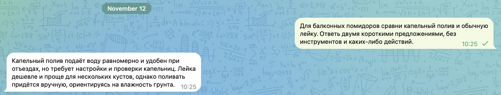
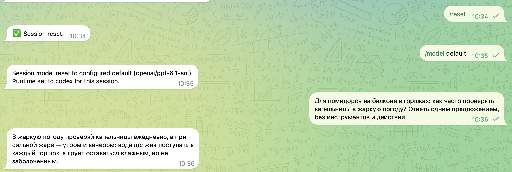
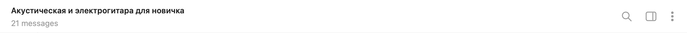
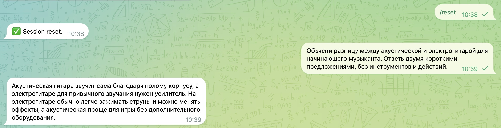

# Telegram naming on the installed Gateway

Actual Telegram Desktop checks on November 12, 2026 (UTC+4), running OpenClaw 2026.11.3 operator build b2b6eb7adf73863f4b5254aada91e0cda8793dc4. This is the integrated Gateway, not the public PR head alone.

1. At 10:25, opened **All → New Thread** and sent an ordinary question about watering balcony tomatoes. No name was entered manually. The first message received an answer and the topic became **Полив помидоров на балконе**.
2. At 10:30, sent six ordinary follow-up questions rapidly. All six were counted, despite being processed in batches: the stored refinement counter reached zero. The existing title still fit and stayed unchanged.
3. At 10:34–10:36, sent `/reset`, then `/model default`, then an ordinary question about the same tomatoes. Neither command renamed the topic. The first ordinary message reconsidered the existing title and kept it.
4. At 10:38–10:39, reset again, then asked about acoustic and electric guitars. The first ordinary message changed the title to **Акустическая и электрогитара для новичка**.

## Actual application captures

First-message title and exchange (two exact crops of the same capture):

Reset, model selection, and continuing the same subject:

Reset followed by a different subject:

The images are lossless rectangular crops of real Telegram UI. Retained pixels are unchanged; unrelated chats, the desktop title and pinned content are omitted. The six-message counter is separate source-state evidence, not a claim inferred from screenshots.

## Validation and limits

The integrated candidate passed 24 context tests, five first-topic pipeline variants, extension types, focused typed lint, formatting, line/test-budget checks, and a complete canonical build. A test fixture was corrected to keep its real session generation; the once-only naming assertion remains intact. The service-only topic event remains silent; a real message batched with it remains a user request and is counted once.

The common naming proposal is tracked in #197334 with #184821, #174317 and #183368. Manual-title/concurrent-rename protections have focused automated coverage; they were not newly proven through Telegram manual-rename UI in this run. This report does not claim all historical conversations, translations, group topics, or every model response were exercised. Public PR CI and maintainer review are separate from these installed-build checks.
