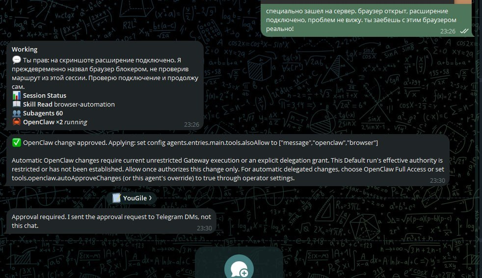

# Approval leaves the current private Telegram topic

Observed on OpenClaw 2026.11.3 with local patches, Linux, Node24.22.1. This is a real user incident, not a clean-main reproduction.

The user was already talking to the bot in a topic inside their private Telegram chat. A delegated OpenClaw configuration change requested approval. The approval card appeared outside that topic, while the topic received:

> Approval required. I sent the approval request to Telegram DMs, not this chat.

It is the same DM. The user has to leave the working topic and find the card elsewhere.

The screenshot shows the card after approval and the topic-scoped notice. It does not show the original pending card or prove its outgoing API arguments. The approval registry recorded allow-once and the configuration hot-reload completed. The session route and approval source session key retained the private topic, and ordinary messages to that topic worked. Raw outgoing chat/thread arguments were not captured, so the historical field-loss boundary remains unproven.

This was a system-agent approval for the openclaw tool, not an exec-command approval. The Telegram native capability handles exec, plugin and system-agent events, but their policies must be checked separately.

Expected: when the authorized approver is the same private-chat user, keep the request, card updates and result in the originating DM topic. Other approvers must keep their own authorized DM targets. A group must not become a destination merely because this private-DM case is fixed. Keep approval decisions and account isolation unchanged.

Related: openclaw/openclaw#125166 and openclaw/openclaw#192162 concern missing group-forum origin metadata; openclaw/openclaw#137437 concerned terminal notices suppressed across different topics. Those are related routing boundaries, not proof this incident has the same cause.

The attached image is the user's original screenshot, without fabricated UI or edited text. Private numeric chat/session/approval identifiers and infrastructure details from the longer incident report are omitted here.
