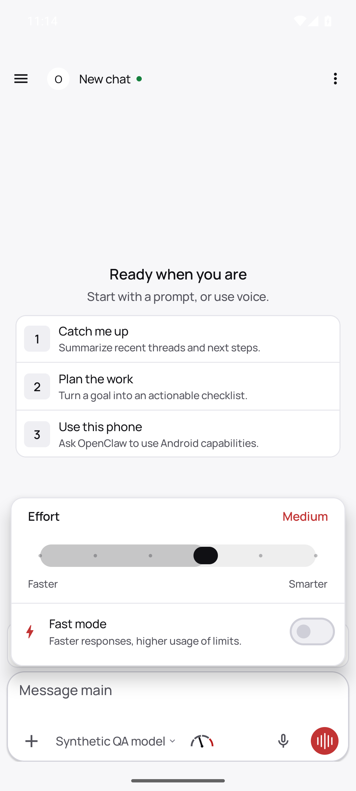
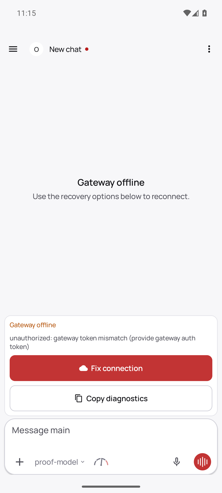

# #163516: actual pending Android intent during native revocation

## Exact environment

- Unchanged Android APK/source HEAD: `a3dd5af5727afd66f3dbedf42cc9a85152bb7ca0`.
- Installed APK SHA-256: `681118665160db825edeacbda7d4e30c9294f55b33052d2ca8e7c3e9f309ea8b`.
- Native Gateway source: `a8b899d9a0039249bc01e362684f6c51c3de40c9`.
- Contributor-owned isolated Android AVD and synthetic QA Gateway/device grant; no production credentials/state. The APK, native session handler and auth policy were not instrumented or modified.

This is a new executed pending-intent observation, separate from the [authenticated read-only proof](https://github.com/dankarization/openclaw/blob/2e6e2bc969a4912b786d2826bc2d6f251e6299e0/proofs/pr-readiness-20261014/android-readonly-current/README.md) and earlier invalid-timing pending attempt. Neither is relabelled.

## Recorded sequence (2026-10-14 UTC)

| Native/fixture time | Observation |
| --- | --- |
| 19:14:42.047 | Real native sessions.list: Thinking Medium, Fast false |
| 19:14:42.335 | Actual Android sessions.patch High reaches the real upstream |
| 19:14:50.440–.441 | Gateway High result is successful; transparent relay temporarily holds that actual ACK |
| 19:14:50.670 | Actual second Ultra UI tap completes while Android still awaits the first ACK; native admin revocation is issued |
| 19:14:51.105 | Native revocation timestamp for the synthetic operator device grant |
| 19:14:51.226 | Revocation RPC completes, **785 ms after the held ACK** |
| 19:14:51.241–.251 | Relay releases the original, unchanged High ACK |
| 19:14:51.257 | Native upstream closes operator socket with **4001 / device removed** |
| 19:14:51.267 | Relay receives the actual Android queued sessions.patch Ultra on its downlink |
| 19:14:52.825 | Native reconnect closes **1008 / unauthorized: gateway token mismatch** |
| 19:15:46.050 | Separate real native sessions.list still reports **High / Fast false**, with the same updatedAt as the admitted High write |

The final native observation is **54,945 ms after the native revoke timestamp**, not more than 60 seconds. Its timestamp comes from the native response; file creation metadata is not substituted for that timestamp.

[Sanitized execution trace and final state](result.sanitized.json) preserve UTC event ordering, native revoke time, UI tap contract and state observations. Actual request IDs are replaced with stable correlation labels; device/session identities, tokens, paths and raw private receipts are excluded.

## Exact boundary and limitation

The relay forwards frames unchanged while its real native upstream is OPEN. Its source queues downlink frames otherwise. Here the native upstream was already closed when the actual queued Ultra frame arrived. That frame was buffered locally and **was not forwarded to a closed native socket**. There is therefore **no native FORBIDDEN response to the Ultra request**, and none is claimed.

This is direct evidence of a real queued Android intent, native device-token revocation/socket invalidation, rejected reconnect, and unchanged final native High state. The conclusion is supported by the actual Ultra request, the two explicit native closure outcomes, the unchanged relay code and persisted state—not by inferring rejection merely from silence or the absence of a patch RPC.

It does not isolate the Android current-scope callback recheck from native socket invalidation, does not prove a queued Ultra handler was entered and denied with FORBIDDEN, and does not prove incomplete-picker canonical preservation through send and queued reconnect. Maintainer review should assess those remaining distinctions; no proof-sufficient or merge-ready status is self-assigned.

## Actual UI captures

Immediately before this executed run, the real native picker is at Medium:

[The corresponding native hierarchy](pending-ready-medium.xml) is included. The separate earlier Ultra-picker capture predates the reset to Medium and is **not included as an intermediate frame of this run**.

After native revocation/reconnect denial the same APK shows the actual offline/token-mismatch state:

These are unedited original PNG captures. They are sequential observations, not synchronized composites; emulator clock text is not used as UTC evidence.

## Executed fixture source and provenance

- [Actual pending fixture](source/pending-fast.mjs): performs actual UI taps, holds the real first ACK, invokes native device.token.revoke through the native Gateway client, releases the ACK, and reads native state. The initial ACK wait is 35 seconds to accommodate the actual slow first patch. The critical held-ACK-to-revoke validity bound remains **5 seconds**; the observed 785 ms passes that bound.
- [Actual transparent relay](source/relay.mjs): no fabricated Gateway auth/scopes/results and no new session handler. ACK holding and the post-close buffering behavior are explicit.
- Existing synthetic native Android credential helper is available with the prior read-only proof linked above. It invokes the unchanged APK's actual identity/auth stores; all generated identities/grants remain private.

The two public source copies substitute only their private QA task-root literal. Control flow, timing bounds, API calls and UI contract are unchanged. No new runtime or build was executed during publication.

An earlier 7-second initial-ACK attempt failed to capture an approximately 26.5-second native patch delay; another earlier attempt completed revocation too late and let a second write reach Gateway. Those attempts remain invalid/incomplete and are not proof of rejection. This bundle records only `pending-fast-1792005276505` and its later separate native state read.
