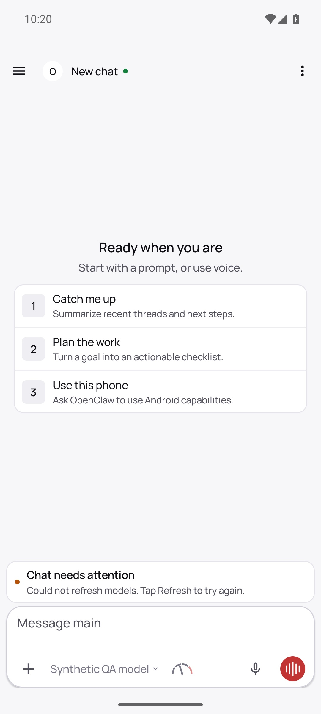
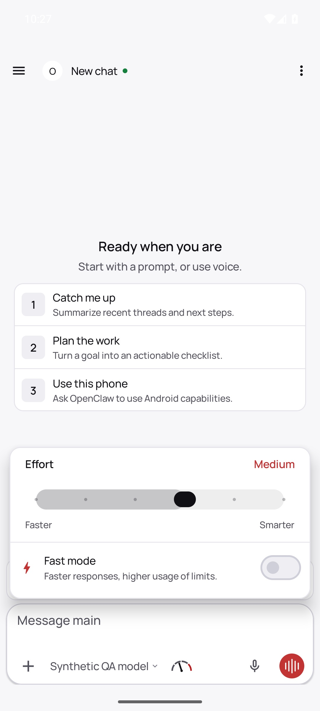

# PR #163516: current-APK authenticated read-only proof

Run: 2026-10-14, contributor-owned isolated Android AVD and native Gateway.

## Source identity

- Unchanged Android APK HEAD: `a3dd5af5727afd66f3dbedf42cc9a85152bb7ca0`.
- APK SHA-256, verified from the installed package after boot: `681118665160db825edeacbda7d4e30c9294f55b33052d2ca8e7c3e9f309ea8b`.
- Native Gateway source: `a8b899d9a0039249bc01e362684f6c51c3de40c9`.
- API 35 Google Play x86_64 AVD; no production credentials, profiles, or messages copied.

## Behavior and boundary

1. The real APK connected as `operator` with exactly `operator.read`, using its native device identity and Gateway-issued device token.
2. The actual Thinking control has `enabled=false` on its clickable native parent. Tapping it did not open the effort picker.
3. A transparent loopback relay forwarded two explicit negative-control RPCs on that same authenticated Android operator socket: Thinking `high`, then Fast `true`. Both were rejected with `FORBIDDEN / MISSING_SCOPE / operator.write`.
4. Native `sessions.list` before and after returned Thinking `medium`, Fast `false`. Neither mutation changed persisted state.
5. As a positive UI control, the same APK/backend reconnected with native `operator.read` + `operator.write` (without admin), and its effort picker opened. See the second image.

`result.json` records the two explicit forwarded RPCs separately from actual UI behavior. These RPCs are **not** presented as emitted by disabled UI controls.

The APK was not patched or instrumented. A test-only helper invoked the APK's existing DeviceIdentityStore and DeviceAuthStore under its own AVD UID to install the synthetic scoped grant; the real Gateway issued and enforced that grant. The relay observed real connect/results; no hello/auth/scopes response was fabricated.

## Known limits

The screenshot also shows an unrelated model-catalog refresh error in this QA backend. The positive write-scope control opens the picker on the same backend despite that condition; successful model inference is not claimed here.

This bundle does not yet establish pending-write revocation before final effect, or incomplete-picker canonical preservation through send and queued reconnect. An earlier pending test exceeded the first request's wait window and the second write reached Gateway before revocation; that attempt is explicitly not rejection proof.

No production installation or configuration changed.

## Images and source provenance

The published JPEGs are quality-85 transcodes of the original PNG captures, with no crop, redaction or content edits. Originals remain in the QA workspace. [Native hierarchy XML](readonly-disabled-effort.xml) records the disabled clickable effort parent.

[Actual relay source](source/relay.mjs) and [actual native credential helper source](source/OpenClawNativeCredentialFixture.java) accompany this result. The public relay copy substitutes only its private QA task-root literal. Helper-generated identity/grant files, tokens and raw private logs are excluded. These helpers are specific to an isolated synthetic AVD; the Java helper's app-private export contains a synthetic private identity and must never be published.

The original two negative RPCs were executed inline. A separate original program file was not present in the collected files. [Reconstructed reproduction helper](readonly-negative-controls.reconstructed.mjs) preserves the recorded request operands and uses the same actual Android socket through the actual relay. It is explicitly **not** the original inline capture source, has not been run for the recorded 75 ms result, and defaults to dry-run. It does not simulate UI taps or claim its RPCs originated from disabled controls.

To reproduce only those negative controls after setting up your own authenticated read-only AVD/relay, supply its disposable session key; inspect the dry-run before opting into execution. The captured result.json remains the executed evidence, not output synthesized by this reconstruction. No pending-revocation or incomplete-picker/send/reconnect success is added by this package.
