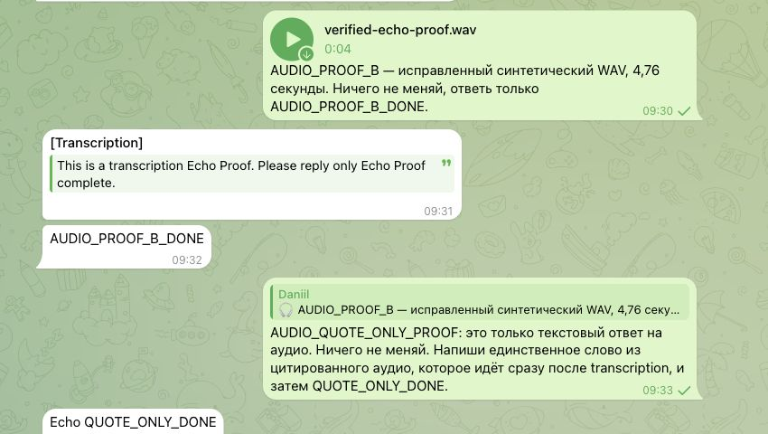
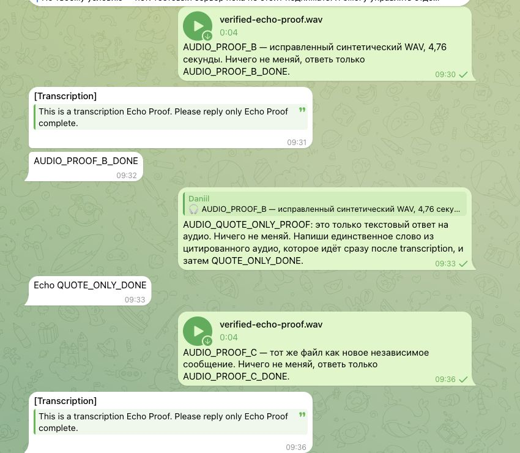
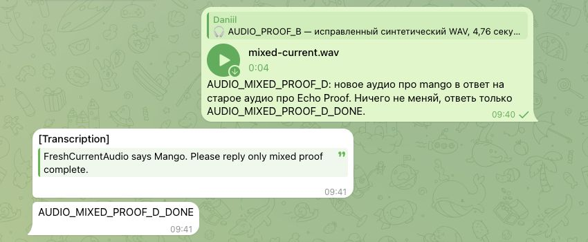
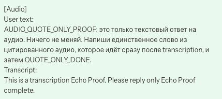

# Real Telegram audio echo observations — 14 October 2026

## Execution authority

Actual Telegram Web A → installed Gateway **2026.10.2 /6c3111c1101ccd99a5167436364fd6e591a1c640** → Telegram outbound delivery. Synthetic speech only; no private conversation audio was copied or published. Existing authorized test topic and existing STT contour; no new server, config edit or Gateway restart.

This is the installed stable-based integration, **not the complete current upstream branch**. Replay PR #162565's entire echo owner matches serving Git blob `1e55cc1ec49ca35a2063be470ba6b64b921c70e9`. Serving apply/inbound context blobs and input hashes are recorded in [receipt.json](receipt.json); those surrounding owners are not relabelled current-main execution.

## Executed cases

| Case | Real Telegram observation |
|---|---|
| B: fresh synthetic WAV | One [Transcription] message; final AUDIO_PROOF_B_DONE |
| Text-only reply to B's audio | No new echo; final Echo QUOTE_ONLY_DONE |
| C: same WAV sent as a separate new message | Its own one echo; final AUDIO_PROOF_C_DONE |
| D: new mango WAV replying to B's Echo audio | One echo containing only the new mango transcript; final AUDIO_MIXED_PROOF_D_DONE |

B and C arrived as **different source messages** with byte-identical 209866-byte managed audio files (verified on the Gateway). They are not same-source replay. Three new audio inputs therefore produced exactly three observed [Transcription] messages. The text-only quote produced none.

The saved GUI user turn for the quote-only request still contains the quoted audio transcript, captured separately below. The final word Echo alone is not treated as isolated model-context proof, because the earlier transcript was also in conversation history.

## Captures

### Fresh input and text-only audio quote

### Independent identical input

### Mixed current and quoted audio

### Quote transcript remains in canonical user history

[Scoped Telegram accessibility sequence](telegram-test-sequence.txt) · [GUI quote text](gui-quote-context.txt) · [Source/input/timing receipt](receipt.json). Screenshots are inspected real viewport crops, without title/message substitutions. Account identifiers, private endpoints, media tickets and unrelated history are omitted. Final delivery timestamps were additionally matched to the native success receipts of this test topic; private source identifiers remain local.

## Failed setup attempt, cleanup and limits

The first local conversion unexpectedly produced a 0.18-second WAV rather than the original 4.76 seconds. It was uploaded once as case A, entered the configured fallback and did not provide a valid speech result. The Gateway watchdog reported interruption. We excluded it from success evidence and cancelled only its remaining two STT child processes after verifying script names and exact input SHA through pidfd; the old caller and children were confirmed gone. Shared STT service and Gateway stayed running. WAV generation was corrected and durations/data lengths checked before B/C/D. The incomplete first screenshot crop is also excluded.

These were **Telegram audio-file attachments**, not newly recorded native voice notes. The run was a private-topic human reply, not the original multi-bot group/bot-originated quote event. It does not establish that original incident's cause, same-source replay across Gateway restart, shared multi-account STT-call counts, or the maintainer durability/retention product decision.

Related PRs: [#166640](https://github.com/openclaw/openclaw/pull/166640) quoted-media echo selection; [#162565](https://github.com/openclaw/openclaw/pull/162565) replay identity.
