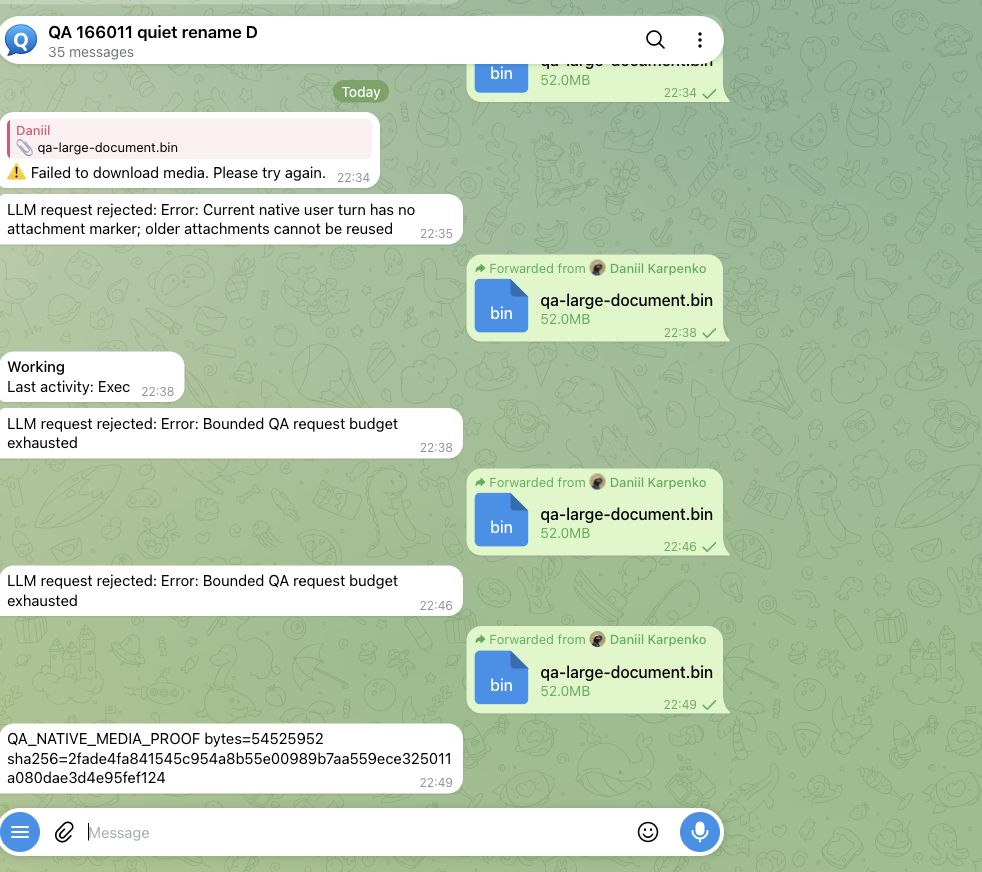

# #170200: complete real Telegram → native Gateway → agent exec → Telegram reply

## Result and exact source

**PASS for the host-exec roundtrip on 2026-10-14.** This is a new complete Gateway run; it does not relabel the earlier native-handler-only harness as a full run.

- Executed PR HEAD: `b6e89d0ee6988565f74bc1b82778f8df65196f32`.
- Executed tree: `596e9f727453cd8a4d05d69b0fbf3768d6a8ff30`; product checkout clean before and after the run.
- Node 24.21.0, exact-head frozen dependencies, source-run native Gateway and source plugin SDK resolution.
- Synthetic `qa-large-document.bin`: **54,525,952 bytes (52 MiB)**; SHA-256 `2fade4fa841545c954a8b55e00989b7aa559ece325011a080dae3d4e95fef124`.
- Successful fixture attempt `2026-10-14T18-48-28-367Z`: one native exec requested at `18:49:51.768Z`; its actual tool result observed at `18:49:52.018Z`; exactly two model requests in this successful attempt.
- Actual Telegram Web showed the checksum response at **22:49 Asia/Tbilisi / 18:49 UTC**. Gateway later shut down cleanly; parent process session exited 0. The provider and task-only transport forwards were stopped afterward.

The visible chat title predates this media scenario and comes from the same owned QA conversation's earlier topic-renaming proof. The earlier visible errors are failed fixture/setup attempts, not the accepted final result.

## What ran

1. The operator forwarded the synthetic 52 MiB document through **real Telegram Web** to a contributor-owned QA bot.
2. The unchanged native Gateway was started with normal Telegram polling enabled. Its ordinary polling, spool/intake, actual Bot API `getFile`, managed-media creation, reply preparation, and local staging owners ran. No captured update was manually injected into this complete Gateway run, and no handler/context/staging/tool implementation was replaced.
3. A configured channel allowance of **128 MiB** and account allowance of **64 MiB** admitted and staged the document into the isolated host workspace. Sandbox mode was `off`, and the only allowed agent tool was native `exec` with host `gateway`.
4. The real agent model request contained that native staged attachment path. The deterministic OpenAI-compatible fixture selected the path from this request and emitted a normal `exec` tool call containing `wc -c` and `sha256sum` against it.
5. The native agent/tool owner executed the command. In the next actual model request, the exec call and tool result had the same opaque wire ID. The result contained **54,525,952 bytes**, the same staged path, and the original checksum.
6. The fixture extracted the byte count/checksum **only from this actual paired native tool result** and returned the assistant answer. The ordinary native Telegram outbound path delivered `QA_NATIVE_MEDIA_PROOF bytes=54525952 sha256=2fade4fa841545c954a8b55e00989b7aa559ece325011a080dae3d4e95fef124`, which was inspected in the real Telegram DOM and screenshot above.

The fixture does not open or read the attachment. It is deterministic orchestration, not evidence of model intelligence. Its request path checks, bounded exec request, native paired-result consumption, and refusal to reuse a previous user turn's attachment are visible in [the provider source](full-provider.mjs). Native call IDs can be rewritten; acceptance pairs the actual assistant exec call with its actual tool result inside the current user turn, without assuming a fixture ID prefix.

## Transport mapping and privacy

The existing local Telegram Bot API was accessed via a task-owned loopback SSH forward. Its actual `getFile` response gives a host-local absolute document path on another machine. Only this bot's own synthetic QA document was copied to a task-owned mirror, verified by size and checksum, and placed as a **regular file** at the exact QA path returned by the actual API. The narrowly trusted QA document parent was configured explicitly. The native API response was not mocked or rewritten; no production configuration or services were changed.

The screenshot is an owned synthetic QA conversation. Raw token-bearing Bot API paths, credentials, chat/message/file IDs, endpoints outside loopback, complete model requests, raw Gateway logs and original configuration stay private. Public API excerpts consistently replace workspace paths and the opaque tool call ID; immutable hashes bind the excerpts to private captured requests. No production key was used by the proof Gateway.

## Artifacts and reproduction contract

- [Run/source identity, hashes and limits](run-summary.sanitized.json).
- [Successful provider events](provider-events.sanitized.json).
- [Selected actual model API call/result fields](model-api-current-turn.sanitized.json).
- [Telegram DOM/screenshot observer receipt](telegram-ui-verification.sanitized.json).
- [Native Gateway launcher](full-gateway.mjs), [process owner/cleanup launcher](full-run.sh), [deterministic model fixture](full-provider.mjs).
- [Redacted native configuration](config.sanitized.json), including the actual host runtime and allowance choices.

Launcher/provider source is as executed except the contributor's absolute task root was consistently replaced by `/QA_ROOT`; hashes for both the original and public copies are recorded in the run summary. The provider's console-ready string retained the stale label `fixtureRevision=3`; the successful event records and actual source `record()` identify **revision 4**. No product behavior was changed to produce this result.

A reproducer must create a fresh isolated profile, substitute their own task root/token file/allowed user and exact own-Bot-API file mapping in the configuration, and supply the same synthetic bytes through real Telegram. Preserve channel polling, native tools and auth; do not replay the private update or fabricate Telegram context. Start the published provider/Gateway with the process owner script and forward a fresh document. The launch guard prevents accidental reuse and the owner script bounds runtime and stops its own processes. The successful run reused the native Gateway from the preceding failed fixture attempt, replaced only the deterministic provider, and used a fresh real document forward.

Earlier attempts remain archived privately and are excluded from acceptance. One lacked the current document's regular QA file mapping; others incorrectly assumed tool IDs kept a particular fixture prefix and exhausted the bounded tool request budget. The screenshot retains those errors as context. Fixes were confined to QA transport mapping and fixture result handling; the PR product tree stayed unchanged.

## What this closes, and what it does not

This artifact supplies the previously missing **ordinary native Gateway polling → real Telegram download → staged host path → normal agent exec → Telegram-visible reply** on the exact PR source. Earlier [native-owner baseline/candidate proof](https://github.com/dankarization/openclaw/blob/10ed4b677c2abd17fd285811953af3f0b35b398f/proofs/pr-readiness-20261014/media-current-live/README.md) separately supplies the clean-main 50 MiB causal rejection, account/channel precedence cases, and unchanged managed-reference compatibility.

It is **not** the maintained leased Telegram Test Server lane; no access to that lease was available. Whether this contributor-owned real Telegram lane is acceptable remains an [explicit owner question](https://github.com/openclaw/openclaw/pull/170200#issuecomment-6174771749). It also does not establish local Docker sandbox execution, SSH sandbox behavior, an installed latest-stable upgrade preserving settings/media, a 4 GiB stress test, an aggregate disk budget, or maintainer approval of the resource policy. Latest-stable upgrade compatibility remains open. The separate 4 GiB / aggregate-budget / #169163 precedence decision is still required; no proof-sufficient or merge-readiness label is self-assigned.
