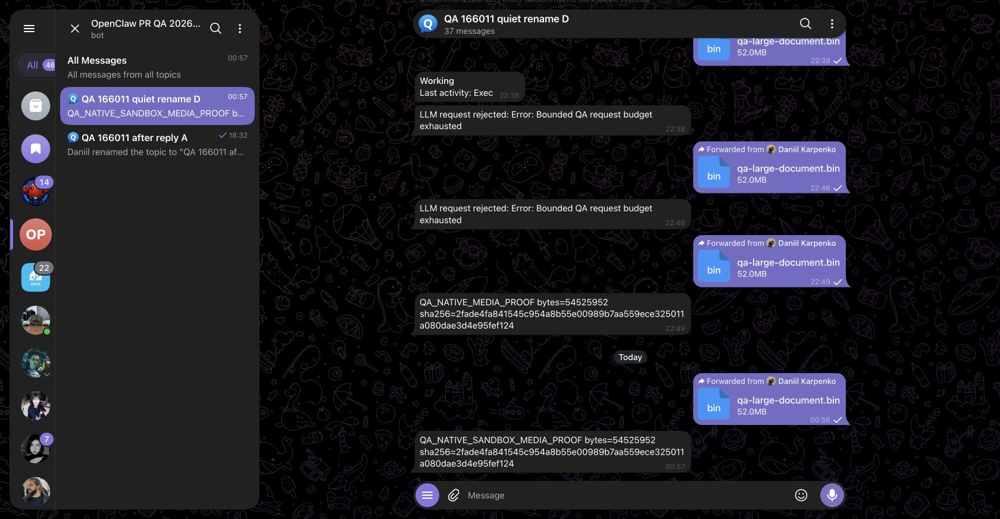

# PR #170200: actual native Docker sandbox media proof

Executed exact published `b6e89d0ee6988565f74bc1b82778f8df65196f32`, clean source, on 2026-10-14 at 20:57 UTC (October15 local). This adds the missing sandbox boundary to the [accepted ordinary host-flow proof](https://github.com/dankarization/openclaw/blob/874733b45c4b9409ca7221a50292ebc362ab261d/proofs/pr-readiness-20261014/media-full-gateway/README.md); it preserves that evidence's distinct provenance.

## Observed flow

A real Telegram user freshly forwarded the synthetic52MiB document to the contributor-owned QA bot. The normal native Gateway polling handler called the real existing local Bot API, admitted/downloaded the attachment, and staged it through native sandbox owners. The current model request contained the actual sandbox-relative attachment path. The deterministic model fixture requested ordinary native exec with that exact path and `/workspace` workdir.

The real tool executed inside the native Docker sandbox, observed `/.dockerenv`, and returned **54,525,952 bytes** with SHA256 `2fade4fa841545c954a8b55e00989b7aa559ece325011a080dae3d4e95fef124`. The second actual model request carried that paired native tool result. The fixture's final reply was sent successfully by the Gateway and observed in Telegram:

`QA_NATIVE_SANDBOX_MEDIA_PROOF bytes=54525952 sha256=2fade4fa841545c954a8b55e00989b7aa559ece325011a080dae3d4e95fef124`

The original unmodified screenshot includes earlier QA host-flow attempts above today's sandbox run. Only the bottom52MiB delivery at00:56 and `QA_NATIVE_SANDBOX_MEDIA_PROOF` at00:57 are this run's acceptance. Earlier request-budget errors and the older host prefix are not sandbox results.

## Native runtime and files

Canonical exact-source `scripts/sandbox-setup.sh` built the pinned Debian Dockerfile without modification. Tag `openclaw-sandbox:qa-170200-b6e89d0`; actual image ID `sha256:19d89d88692ade093b225f6bf7a4e28330afe170433204e04358b7a3484291e8`. Pinned base: `debian:bookworm-slim@sha256:3783cc01769c7b2b1b83a5c5ad96c815348e28ed7da68e2e3687004faa906251`.

Native Docker inspect confirms networknone, read-onlyroot, all capabilities dropped,512MiB memory/swap,1CPU,pids128. Native `/workspace` and read-only skills mounts both originate inside the task-owned sandbox profile. See [runtime receipt](docker-runtime.sanitized.json).

- [Selected actual model/tool request and result](native-model-tool.sanitized.json): exact pairing preserved, paths/opaque IDs consistently replaced.
- [Provider events](provider-events.sanitized.json), [run summary/source hashes](run-summary.sanitized.json), [sanitized configuration](config.sanitized.json).
- Executed fixture source: [native Gateway bootstrap](gateway.mjs), [deterministic provider](provider.mjs), [launch envelope](run-after-slot.sh), [canonical image-build invocation](build-image-after-slot.sh), [workspace instructions](workspace-AGENTS.md).

## Disclosure and limits

The Gateway, Telegram intake/getFile, staging, sandbox, authentication and exec tool are real native owners. The model endpoint is a deterministic orchestration fixture and never opens the attachment. Existing local Bot API is reached by loopback SSH forwarding; only this synthetic QA-bot file is mirrored as a regular file at its actual returned absolute path on the isolated QA host. No getFile response/path rewrite, mock download, fake staging or injected update.

Native full configuration validation passed with no warnings before launch. Source Gateway completed a clean shutdown after acceptance. Private tokens, infrastructure endpoints, raw captured/model/log data and physical identity values are excluded.

This is not maintained leased Test Server qualification, a packaged/stable installation upgrade, a4GiB stress test, an aggregate-budget decision, or maintainer security/product approval. Those limitations remain separate.
