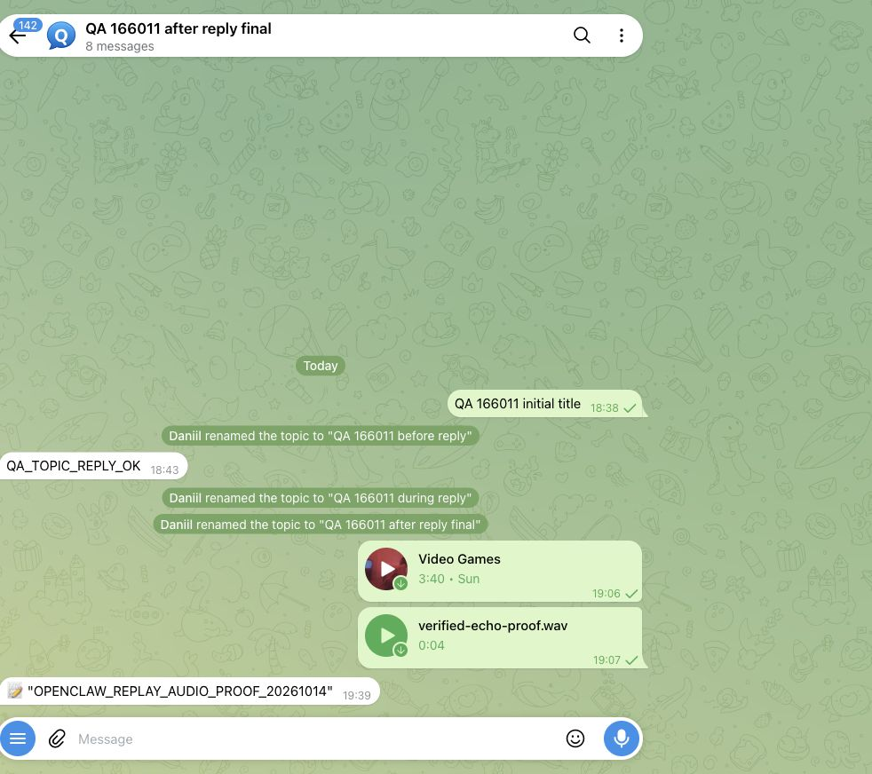
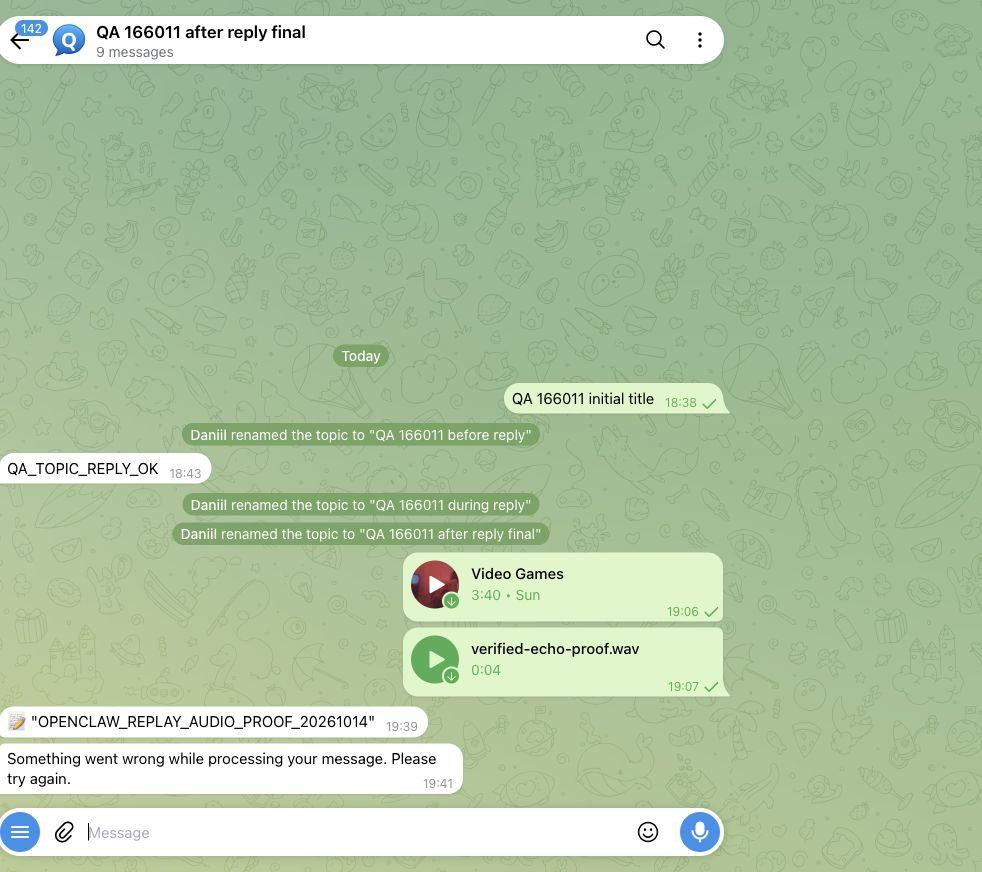
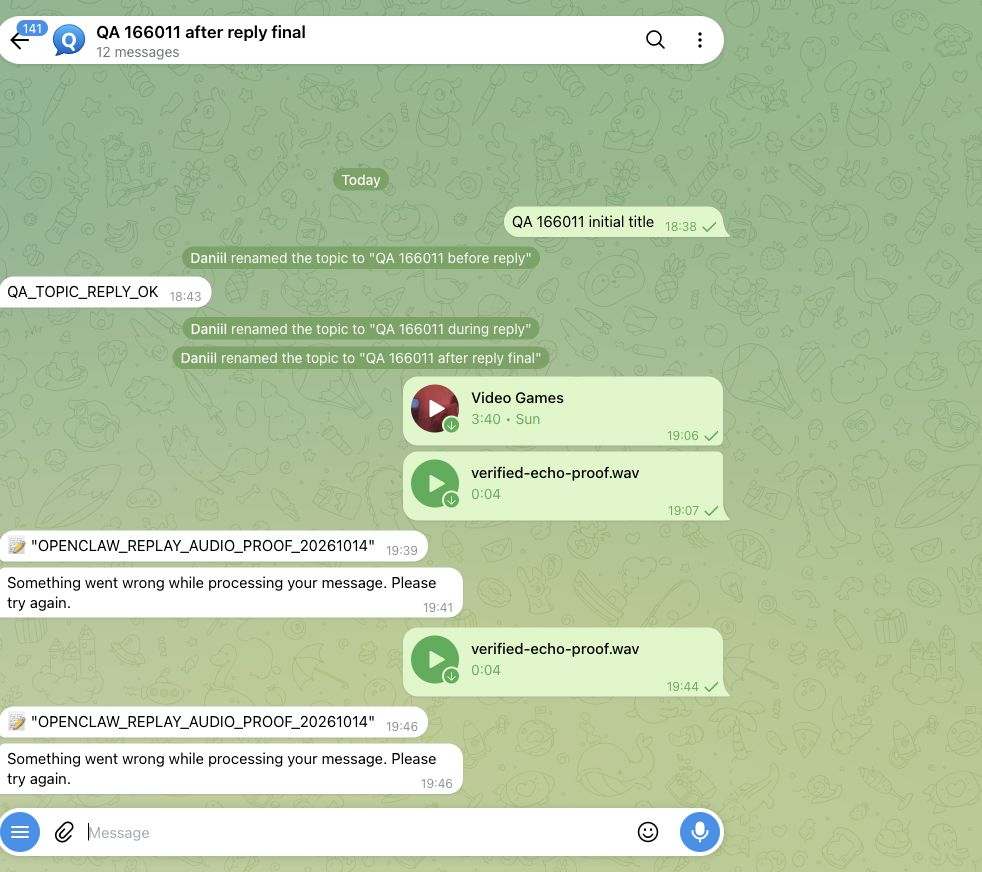
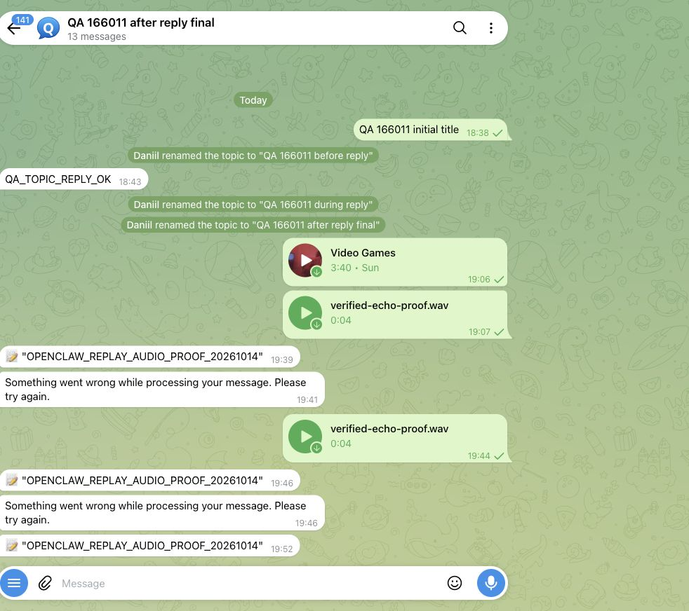
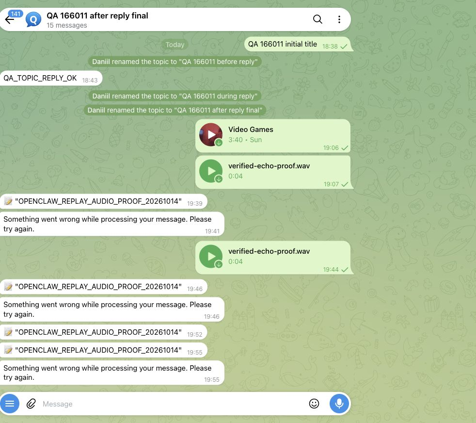

# PR #162565: real Telegram native-handler crash/replay proof

Executed 14 October 2026 with a dedicated operator-authorized QA bot and isolated state. Production Gateway and bot credentials were not used.

## Result

| Source | First processing | Same-source process replay | Independent identical audio |
| --- | --- | --- | --- |
| Candidate `cd93172f2f897a6675bb58f44b0e400af3f0872b` | One Telegram echo, stable receipt completed | **No second echo**; new process executes the echo owner again and retains completed receipt | A different real source produces its own echo |
| Pinned main `c05c277d04326b53858f85e2ea83c16b4756e83b` | One Telegram echo | **Second echo appears**; native Telegram sender called again | Not repeated on baseline |

Both replay processes exited 0. The baseline deliberately demonstrates the bug; exit0 is the fixture's completion, not a claim that baseline behavior passes the one-echo expectation.

## Entry point and limits

The authorized operator account uploaded a synthetic four-second WAV through Telegram Web under browser automation. The captured Bot API update was passed unchanged to native `createTelegramBot` / `bot.handleUpdate`, inside the actual local-state owner, activated Telegram registry and native plugin-instance invocation. Native media download, audio preflight, transcript echo, SQLite delivery owner and Telegram outbound execute. No delivery adapter, queue, source identity or dedupe guard is mocked or cleared.

After actual context construction, the fixture records V8 coverage and inspects the delivery through the native owner. Candidate first processing requires the matching stable receipt to be completed. After independently observing one echo in Telegram, the parent SIGKILLs that exact fixture process. A fresh process opens the retained state and handles the identical captured update. Both candidate receipts prove entry into `sendTranscriptEcho`; another guard stopping before that boundary would be INCONCLUSIVE.

**This is native-handler process crash/replay with real Telegram input and outbound. It is not an unmodified full-Gateway/polling/spool restart, nor the maintained leased Telegram Test Server.** Maintainer acceptance of this scope remains explicit. Local STT is deterministic fixture STT, not an acoustic recognition test: it verifies the downloaded WAV SHA-256 `459aa2b820b9b75c684bd5ac0205fc1d432586bb9600996570f996d5614f68a3` and returns a synthetic marker. All five native STT calls verified those bytes, including the independent real source.

The replay/fresh phases intentionally throw a pre-adoption cutoff after the measured boundary. Telegram's generic processing-error bubbles in the screenshots are the expected fixture cleanup effect; no model response is requested. The first process is expected to die at the bounded barrier, not exit normally.

## Evidence

- [Sanitized receipts, coverage and raw-log exports](receipt.json): ten receipts, distinct process IDs, retained-state hashes, identical replay update/source hashes, completed candidate intents, baseline sender calls, crash controls and terminal exits. Config and fixture fingerprints bind the run; private token/config/raw updates are excluded.
- [Exact executed fixture](captured-update-replay.mjs), [deterministic STT](fixture-stt.py). The QA-only paths are explicit; callers supply their own private captured update and config. The script never starts a poller or listener.
- Candidate source tree `c2f5715602f488c94b71a6f7376aef324be8dc22`; echo source SHA-256 `d0fdedc43000b51219c1beee03a3344e4f88475b6cf81a26c80fa9290e037967`. Baseline echo SHA-256 `23af31214e07024677092d98757e4346f54271f0ba2d8cdec08fb69f2cdd6a5e`.
- Source package/lock identities match between candidate and baseline. Baseline uses its own source SDK aliases and copies/hardlinks of the same frozen dependencies, including workspace dependency directories.
- Initial setup failures are excluded from passing runs: legacy QA streaming config rejected; missing plugin invocation scope; baseline initially lacked workspace dependency links. A mistaken update-JSON/audio hash comparison was corrected before the accepted STT runs. No product guard, deadline, assertion or source file was weakened to make a case pass.

The QA topic was reused from #166011; its title is unrelated to the replay PR. Existing setup music is not the synthetic input. Each screenshot shows only this disposable QA topic. Counts below refer to this test marker, not total chat messages.

### Candidate first processing: one echo

### Candidate process replay: still one echo

### Different real source, same WAV bytes: second independent echo

### Baseline first processing: one additional echo (three markers total)

### Baseline replay: duplicate appears (four markers total)

## Remaining owner decisions

This proof does not settle required durable admission, the 24-hour/2,000-entry retention policy, or maintainer acceptance of the documented live lane. It does not claim shared-STT or multi-account admission fixes.
