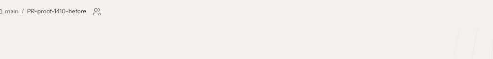
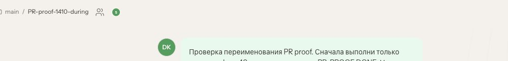
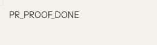
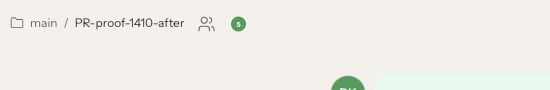
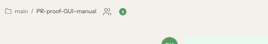

# PR #166011 — real Telegram private-topic rename proof (14 October 2026)

## Execution authority and scope

Executed using the operator's authorized Telegram Web A and already connected OpenClaw WebGUI, on the existing production integration **2026.10.2**, serving source **6c3111c1101ccd99a5167436364fd6e591a1c640**. No QA server was created; Gateway/Codex were not restarted or replaced.

**This is a live stable-based integration proof, not execution of exact current upstream PR head a8b899d9a0039249bc01e362684f6c51c3de40c9.** Its exact-head native and baseline causal proofs are separate: [causal proof](../topic-causal/README.md), [exact-head CI follow-up](../topic-ci-followup/README.md). Do not conflate these scopes.

## Observed sequence

One newly created private bot topic was used throughout. A normal text message from All Messages created it. The existing connected GUI updated without reloading on each Telegram rename.

| Phase | Telegram topic | Connected GUI | Result |
|---|---|---|---|
| Before model request | PR-proof-1410-before | PR-proof-1410-before | Same name |
| During model request | PR-proof-1410-during | PR-proof-1410-during | Same name; Stop generating visible in DOM |
| After final PR_PROOF_DONE | PR-proof-1410-after | PR-proof-1410-after | Same name |
| Reload GUI | unchanged | PR-proof-1410-after | Persisted |
| Explicit GUI rename, then another Telegram rename | PR-proof-telegram-next | PR-proof-GUI-manual | GUI manual title retained |
| Reload GUI again | unchanged | PR-proof-GUI-manual | Manual priority persisted |

The bounded model request instructed only sleep 40 and the final marker. The final marker appeared in Telegram and GUI; the GUI reported completion in 52 seconds. Active-turn observation was recorded at 2026-10-14T05:02:52.195Z. The Telegram during capture shows typing; the GUI header capture shows the updated name. The attempted separate working-status crop was blank and is deliberately excluded, not presented as visual evidence.

## Screenshots

### Before

### While the request was active

### After the final reply and after reload

### Manual GUI title priority

Images are actual viewport crops, inspected before publication; no compositing or title substitution. Private unrelated chats, account identifiers and credentials are excluded.

## Cleanup / limits

The archived root DM caused retries of an earlier root /status command. The operator explicitly authorized temporary unarchive. It was unarchived, topic testing completed, and root archive restored; the UI showed “This session is archived” and Unarchive again. Deleted topics were not restored.

The first-command topic observation is tracked in [Telegram Desktop #31451](https://github.com/telegramdesktop/tdesktop/issues/31451), cross-linked to the distinct [OpenClaw archived-command retry #171754](https://github.com/openclaw/openclaw/issues/171754).

No replay/restart/audio proof was executed in this run. This package does not claim all maintainer proof gates are satisfied.
