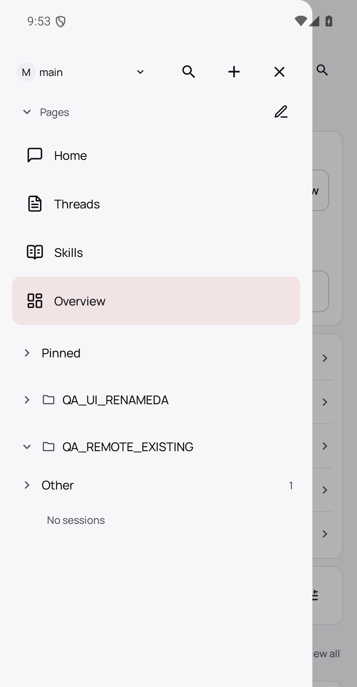
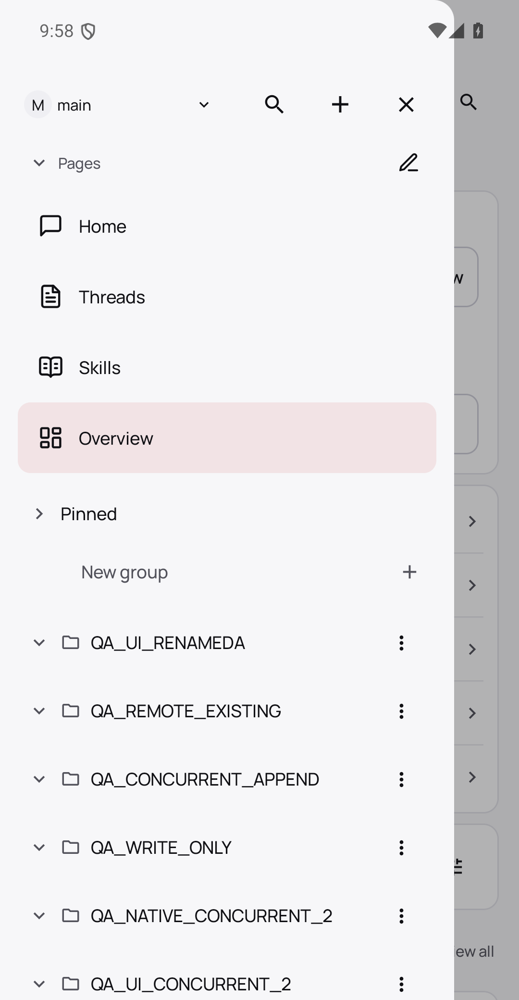
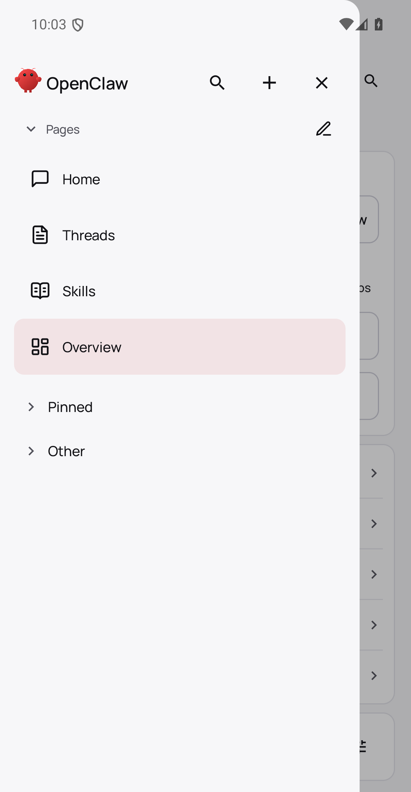

# PR #164857: current Android authority and catalog runtime cells

Published PR head: `fd276434a19b2d59d6e86f07f50b79e0835f4de8`. Native checkout: `4f5782b9ff339053d2b94ee4ceb8364116a9b143`. Both trees: `24f6ffd1a2ec676ac5f2eb2a35d583c60e36575e`. Installed unchanged source-built debug APK SHA256: `6261d369739833fbfdfa3c09192b3918bca96227aa0f3155fae80311ce1c0369`.

## Executed native results

1. **Read-only Android.** Gateway-issued device-token persisted through the APK native DeviceAuthStore. Actual APK operator connection peer8 requested and received only operator.read. Existing empty folders are visible; New group, group menus and reorder controls are absent, including after actual long-press. A separately disclosed supplementary groups.put request on this exact authenticated physical socket receives FORBIDDEN missing operator.write. It is not represented as an Android UI-generated mutation.
2. **Write without admin.** Native device-token grants actual APK peer10 only operator.read/operator.write. Real sidebar UI creates QA_WRITE_ONLY. No operator.admin scope was needed or fabricated.
3. **Concurrent append.** Android real Create for QA_UI_CONCURRENT_2 begins through its ordinary view-model/controller path. Transparent relay holds one unchanged native groups.list response. A different already-connected native GatewayClient appends QA_NATIVE_CONCURRENT_2. Relay releases the exact original response. Actual Android request carries appendOnly:true; native final catalog contains BOTH new groups and all previous groups. Experiment upper interval928ms. See correlated wire and both native readbacks.
4. **Pending operation revoked.** Actual UI Create for QA_REVOKED_PENDING waits on a held genuine groups.list response. Separate native administrator invokes device.token.revoke for that real APK operator identity. Native Gateway closes operator physical peer10 code4001/device removed. Release cannot revive the closed connection: no Android groups.put follows the held response and the catalog equals before; QA_REVOKED_PENDING is absent. Upper interval834ms. Subsequent normal reconnect is rejected; UI reports Saved auth invalid. No fake hello, lease, auth, scope, transport enqueue or database owner is installed.
5. **Catalog retirement.** Actual Settings → Gateway → Forget → confirmation removes this disposable QA gateway. After own app force-stop, read-only copies of native Room/WAL show zero cached_sessions, cached_messages, cached_gateway_owners and cached_session_group_catalogs; cache schema4, durable client schema1. Normal APK relaunch and sidebar show no previous QA groups. No Room/preference row was deleted manually. Other-gateway preservation is not qualified by this single-gateway cell.

## Reproduce / fixtures

Use a disposable AVD, current unchanged APK and native current Gateway. Task-only Java helper invokes unchanged native DeviceAuthStore/SecurePrefs/DeviceIdentityStore; it supplies authentic Gateway-issued QA credentials, never edited token/scopes/hello data. switch-groups-profile.py checks the actual APK granted scopes. Separate native GatewayClient is used for administrator operations. Relay forwards all frames unchanged; it only delays one real response, and its explicitly named supplementary /rpc cell is not claimed as UI-generated traffic. concurrent-groups-native.mjs and revocation-groups-native.mjs connect that second writer BEFORE holding the Android response, then perform the timed experiment. Sources here redact only QA root/host/device identity. Actual UI coordinates originate from the saved real UI hierarchy. Raw private logs and snapshots remain in the task-owned QA directory.

Screenshots are vertical viewport crops [0,0,1080,2080] removing endpoint/status footer; retained pixels unchanged. XML, receipt and wire preserve synthetic labels and hashed request correlation. Native error and closed-socket receipts substantiate the lower-footer auth state without publishing the endpoint.

## Excluded preparation attempts

The initial credential helper cleared a bootstrap credential with asynchronous preferences apply and exited too soon; actual APK connected as admin, so that attempt was NOT called read-only proof. Corrected test helper initializes native registry, waits for persistence and verifies stored/actual socket scopes. Product APK did not change. One held-response attempt expired before the second writer ran. Another started a new native-client process inside a seven-second deadline and timed out. Neither is accepted as concurrent proof; the accepted third experiment uses an already-connected real native writer.

## Explicit remaining qualification

This bundle qualifies real UI capability gating, actual non-admin writes, concurrent append, pending-response revocation and single-gateway native retirement. It DOES NOT claim debugger-paused final physical enqueue or worker SQLite-commit revocation race, different-gateway/same-endpoint replacement, legacy-server append fallback, concurrent reorder, loaded-page preservation, or stable APK upgrade/durable outbox migration. Those cells remain separate. It does not imply security-sensitive maintainer approval or acceptance of shared-catalog/cache product direction. Existing owner questions remain unchanged. QA app/Gateway/relay/AVD were stopped cleanly; production was untouched.
