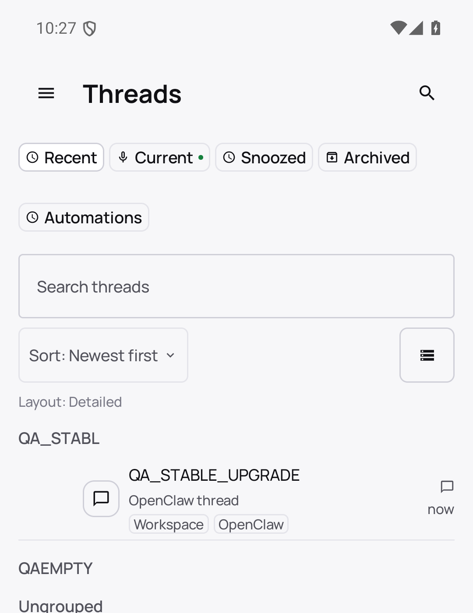
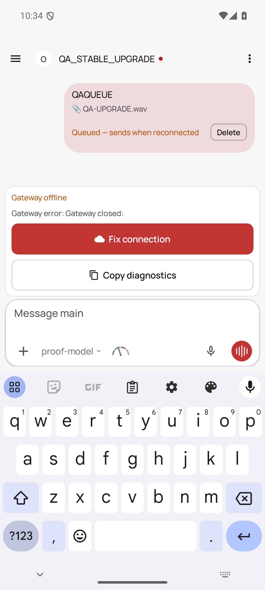
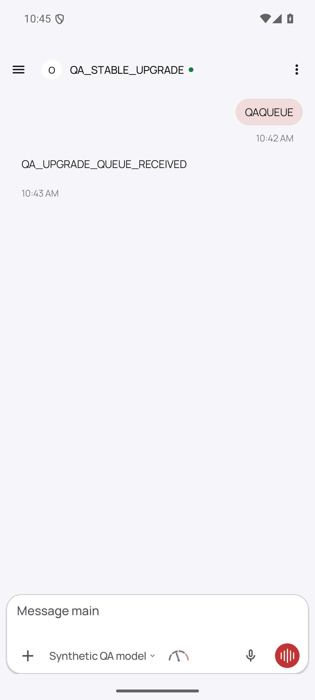
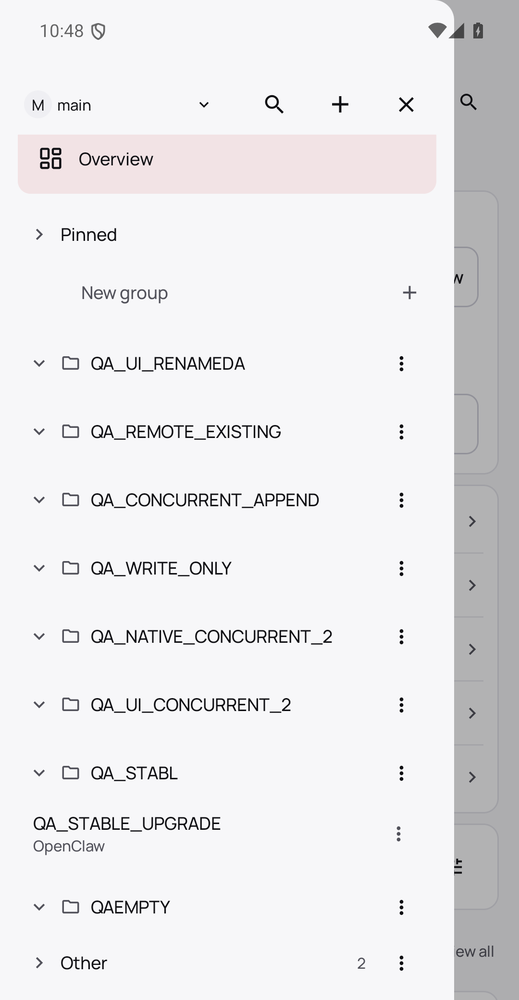

# PR #164857: actual stable Android APK → current APK upgrade

## Exact artifacts and channel

- Stable source v2026.10.3: `59cb44796b0f1f0daa0e37af8b1495abb45d9bc1`, tree `d76c860b59ce485811140aafcf222ec14c6d5ff2`.
- Current published PR `fd276434a19b2d59d6e86f07f50b79e0835f4de8`; actual equivalent native checkout `4f5782b9ff339053d2b94ee4ceb8364116a9b143`, same full tree `24f6ffd1a2ec676ac5f2eb2a35d583c60e36575e`.
- Stable APK SHA256 `fd942a045f877ca47b0833ba653c7bcac75e7275772160d27dd1cf8fd86128ad`; current APK `6261d369739833fbfdfa3c09192b3918bca96227aa0f3155fae80311ce1c0369`.
- Both package `ai.openclaw.app.debug`, native versionName2026.8.2-debug/code2026080201, same personal QA debug certificate SHA256 `dc53b2e95a01aa5a91911e2fc0a16340d7117b5b773ebc364dada2c8827f94e5`. Version strings were not rewritten. Both actually installed APK files were hashed through pm path.

This is the documented source-built/personal-signing debug channel, not the official signed store distribution. Stable source stayed tracked-clean. Its native assemblePlayDebug completed5m18s. Exact declared direct generator/renderer versions were installed in a separate QA npm prefix; actual package-lock is included. It is not claimed identical to a complete pnpm frozen workspace install. Missing Vite and a missing sparse config directory caused two setup failures before the successful unchanged-source build; no assertions/tasks were disabled.

## Native UI inputs authored on stable

The previous disposable QA app was uninstalled BEFORE the fresh stable baseline and BEFORE authoring these inputs. Between stable-authored inputs and current installation there was NO clear-data, uninstall, Room/prefs seed or schema rewrite.

A separate native administrator created only the synthetic session QA_STABLE_UPGRADE using sessions.create. All following legacy/durable inputs were made through actual stable Android UI:

1. Thread menu → Move to group → New group created the actual entered local name **QA_STABL** and assigned this session; the shortened input is retained honestly.
2. Long-press that group header → New group created **QAEMPTY**, verified exact field value before Create. This empty local folder is absent from the native server catalog before upgrade.
3. Actual Files picker imported a freshly generated8044-byte silent WAV, QA-UPGRADE.wav. SHA256 `59460d5690616336b990fc7b1629428e3bd825e422da84469d2c8c8ecfaff43b`. TXT and CSV were disabled by the native picker and are excluded, not claimed as attachment tests.
4. Only the task QA Gateway was cleanly stopped. Actual stable Send queued **QAQUEUE** plus WAV; the UI shows Queued — sends when reconnected. Native durable Room contains one command, one attachment and one byte chunk. A separate unsent QADRAFT was typed, then Android Home saved activity state.

## Actual install-over and native readbacks

`adb install -r` installed the unchanged current APK over the installed stable APK with Success. Same certificate/code, no downgrade flag, data reset or manually seeded migration.

With QA Gateway still OFFLINE, current APK opens normally. Read-only copies of native Room/WAL demonstrate:

| State | Stable before | Current after install-r |
|---|---:|---:|
| Disposable Gateway cache schema |3|4|
| Durable client-state schema |1|1|
| Outbox commands |1|1|
| Outbox attachments |1|1|
| Attachment chunks |1|1|

All columns of all three durable row sets match EXACTLY before/after, including IDs, ownership, prompt, status and attachment metadata. Native chunk bytes preserve the original WAV checksum. Cache projections rebuild as designed; no durable data was rebuilt. Native offline current sidebar still displays QA_STABL and QAEMPTY.

## Native reconnect, migration and usable queue

Restarted the same task native Gateway on unchanged current PR source, with same state and real paired device identity. A disclosed deterministic OpenAI-compatible provider supplies ACKs; it never reads the WAV, stages files or substitutes tools/auth/transport. Actual APK reconnect was requested through its ordinary settings UI and received operator.read/operator.write, no admin.

- The genuine Android migration reads native catalog, sends **exactly one** sessions.groups.put with names:[QAEMPTY],appendOnly:true, and receives native success. Settled independent native readback contains QAEMPTY plus every original server group. An earlier read raced before the migration callback and is not called a successful settled read.
- Read-only native preference inspection confirms legacyConsumed:true, original local names key removed and this Gateway marked migrated; no preference was edited to force these results.
- Saved durable queue emits **one actual native chat.send** for QAQUEUE with real audio/x-wav attachment content; decoded bytes8044 and checksum match the original. Native provider receives this real prompt and returns QA_UPGRADE_QUEUE_RECEIVED. Actual Android displays the reply; native chat.history retains both prompt and reply. This proves restored queue usability, not speech-recognition or semantic-model quality.
- Native final durable outbox commands/attachments/chunks become0 after successful dispatch; cache now has3 sessions,2 messages,1 owner,1 catalog.
- APK force-stop/relaunch still shows QAEMPTY. Wire count remains one migration put and one queue send: neither migration nor queued message repeats.

## Failed / unqualified cells and limits

**Separate unsent QADRAFT was NOT restored by native package update. This is not passing draft-compatibility proof.** Both inspected versions hold these composer drafts through SavedStateHandle rather than the durable Room tables; this experiment does not establish a PR-caused draft regression, and no unrelated draft feature/fix or same-stable reinstall counterfactual was added. The durable queue/attachment cells above are independent and passed.

Native backend during APK upgrade is current PR Gateway, not a packaged stable→candidate Gateway upgrade. Legacy-server append fallback, full loaded-page preservation, concurrent reorder, same-endpoint replacement, final physical enqueue / worker commit revocation race, official signed store-channel upgrade and area-owner/security approval are not claimed here. Previous immutable native authority/concurrency/revocation/Forget proof remains a separate bundle. No production configuration/runtime, user phone or user signing key was touched. Task-only app/Gateway/provider/relay/AVD stopped cleanly; QA state and personal debug key retained.

All UI images were inspected. Folder images are disclosed vertical crops removing other device rows/endpoint footer; chat images are unchanged full frames. XML, source/build/install receipts, correlated sanitized wire, native catalog/Room readbacks and executed native-wrapper/helper/provider sources are included. Raw private state stays only in the QA task directory.
