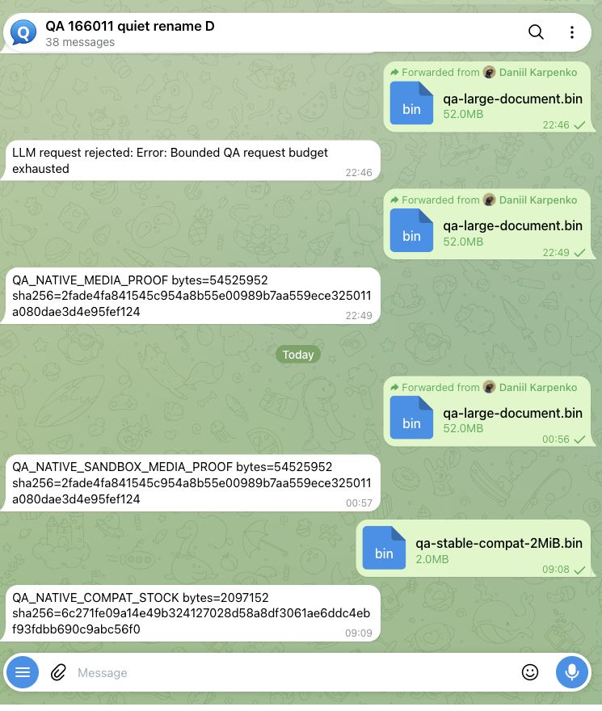
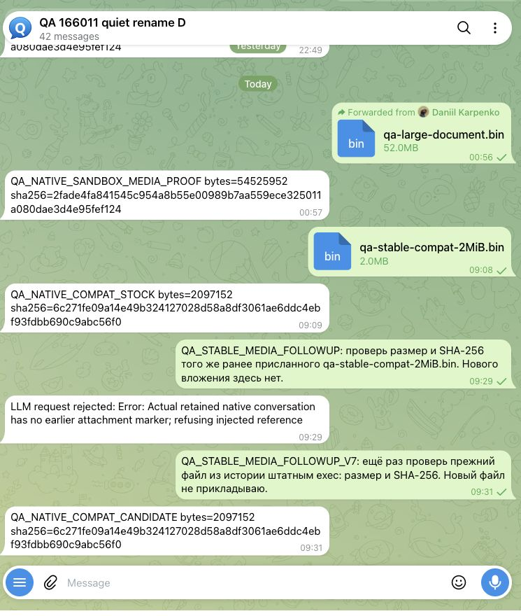

# PR #170200 — latest-stable existing-media compatibility

Executed 2026-10-15, Asia/Tbilisi. [Machine receipt](receipt.json).

## Exact inputs

- Official unchanged v2026.10.3 package: commit `59cb44796b0f1f0daa0e37af8b1495abb45d9bc1`, package SHA-256 `761685d010d96645d1deabe19299ecde263eac3f2489a17322f48c461a1130a5`.
- Exact unchanged PR head `b6e89d0ee6988565f74bc1b82778f8df65196f32`, tree `596e9f727453cd8a4d05d69b0fbf3768d6a8ff30`; tracked checkout clean before/after.
- Same Linux QA state directory, config file, workspace and actual native session throughout. No copied databases, seeded transcript rows, fabricated media identities or reference rewrites.
- Existing synthetic document: **2,097,152 bytes**, SHA-256 `6c271fe09a14e49b324127028d58a8df3061ae6ddc4ebf93fdbb690c9abc56f0`.
- Native account limit **64 MiB**, channel limit **128 MiB**, both retained after migration.
- This is **stored-data / runtime compatibility via native Doctor migration and same-profile Gateway handoff**, not an npm installer acceptance claim. The separately accepted host/Docker 52 MiB bundles establish the size regression; this cell isolates existing stored data.

## Executed flow

1. Install the normal official stable package into its own QA prefix. Native `config patch --dry-run`, apply and `config validate` establish the isolated profile.
2. Send the real 2 MiB document from Telegram Web to the dedicated QA bot. Observe actual pending Bot API update and `getFile` without advancing its offset, then mirror **the actual downloaded bytes** from the existing local Bot API filesystem to that same allowlisted synthetic-document path on the separate QA filesystem. Verify the known hash. No update, attachment metadata or path is injected into Gateway.
3. Launch the unchanged official stable Gateway and normal Telegram poller. It consumes the actual Telegram update, creates managed inbound identity, stages the file, runs the ordinary native `exec` tool against the staged path, and sends `QA_NATIVE_COMPAT_STOCK` with the correct size/hash.
4. Read native `sessions.list` / `chat.history` using the matching official CLI. Record session ID/key, completed status, actual workspace attachment and a semantic config hash. Stop the owned stock Gateway cleanly; confirm it and its provider exited and both owned ports closed.
5. An initial direct source-Gateway startup correctly refuses the stable agent schema **24**: this candidate expects schema **26**. Run the candidate's **native `doctor --fix --yes --non-interactive`**, which exits **0** and performs its normal migrations. No schema guard bypass or manual database repair occurs.
6. Launch the exact PR's native Gateway startup and ordinary Telegram polling on those same persisted inputs. The package manifest still says 2026.10.2, and its native warning is disclosed; the executed source identity is the pinned PR head, not relabeled as a release.
7. Send a new **plain text** Telegram request, without another attachment. The deterministic model fixture consumes the actual retained conversation's previous paired native exec result to discover the old workspace path. It requests a **new ordinary native exec** of `wc -c` / `sha256sum`, consumes the new paired result and sends `QA_NATIVE_COMPAT_CANDIDATE` with the **same bytes/hash**.
8. Read the native session/history/config and file again, then cleanly stop only the owned QA Gateway and fixture.

## Observed outcome

| Boundary | Actual result |
|---|---|
| Stable real Telegram intake → native staging → native exec → Telegram reply | 2,097,152 bytes, correct SHA-256 |
| Native Doctor migration | exit 0; schema 24 input admitted by candidate schema 26 after migration |
| Candidate plain followup → retained reference → new native exec → Telegram reply | same 2,097,152 bytes and SHA-256 |
| Original native session ID and key | retained |
| Native history | both stock and candidate acknowledgements; new followup and tool result retained |
| Native run | done; no active run |
| Original staged workspace attachment | same relative path, bytes and SHA-256 |
| Account / channel limits | 64 / 128 MiB retained |
| Original configured values | retained against native last-good whose semantic hash exactly matches recorded stock baseline |
| Config bookkeeping | native meta/wizard excluded; additive native wizard/skills/roster/group-allowlist normalization disclosed; not byte-identical config |
| Candidate HTTP healthz / readyz | **200 / 200** |
| Cleanup | owned Gateway and fixture exited; owned ports closed |

## Screenshots

Only the test conversation is retained; the user's other-chat list is excluded. Earlier QA attempts remain visible and are not erased or presented as successes.

### Official stable receives/stages/reads the document

### Same data after native migration, plain followup and new native exec

## Fixture and qualification boundaries

- [Stock orchestration fixture](provider-stock.mjs), [executed candidate revision 7](provider-candidate-v7.mjs), [native source-Gateway bootstrap](gateway-candidate.mjs). Absolute QA task root alone is redacted; original source SHA-256 values are in the receipt. Fixtures select native tools and inspect model-wire tool results; they never open/read the attachment themselves.
- Candidate revision 6 initially expected the transient attachment marker. Native saved history instead contains the stable-authored completed exec reference. Revision 7 parses that actual retained, paired native exec result. The preserved revision-7 event label still says “earlier user attachment marker”; that **label is inaccurate**, while the linked executed `resolveCurrentTurn` code and captured native conversation establish the actual paired-result path. No transcript or native reference was rewritten to satisfy the fixture.
- Direct startup before Doctor and the revision-6 failed followup are excluded attempts, retained visibly. They do not constitute a product regression introduced by this media change.
- Doctor's original-state capture warned about a group-writable QA ancestor; native pre-migration SQLite backups were retained, and native last-good matches the original config hash. No unrelated directory-permission or storage changes were made.
- This is a dedicated normal Telegram contributor lane with a local Bot API and deterministic model, not Convex-leased Test Server userbot evidence. [Explicit owner exception request](https://github.com/openclaw/openclaw/pull/170200#issuecomment-6174771749) remains unresolved.
- [Resource-policy question](https://github.com/openclaw/openclaw/pull/170200#issuecomment-6143543007) remains a maintainer decision. This proof does not grant or claim that decision.
- Previously accepted [real 52 MiB host/Docker staging proof](https://github.com/dankarization/openclaw/blob/1df4fa39baba14bf2e3d48f701210565aa3ab500/proofs/pr-readiness-20261014/media-sandbox-live/README.md) is complementary and was not rerun.
