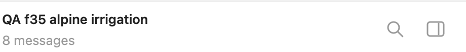
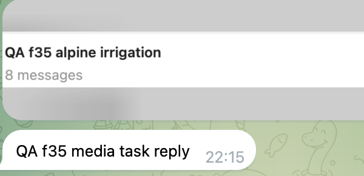
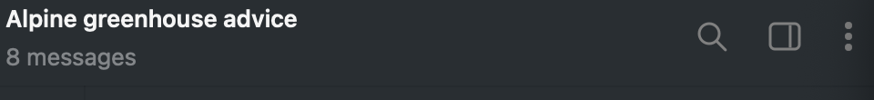
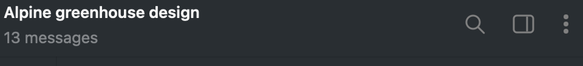
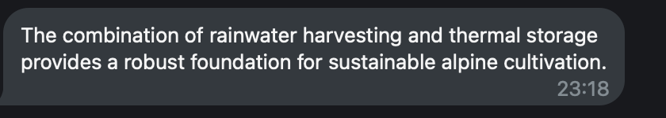

# PR #174317 runtime evidence — f35cd67

Tested published commit: `f35cd67be5fe60ae8d0802c4bd17cfe9c7743ee6`.
Source tree: `3a85f9dcb96188e8a4bda60be0b20be7f5c4571f`.

**Telegram transport and user actions were real. Scenarios 1–5 use the repository's deterministic provider for precise race synchronization. Scenario 6 uses the actual `gemma4:12b` through the existing durable Ollama queue.** These executions are fresh runs of this published head, not reuse of the older b66 receipts.

## Artifact identity and local validation

Normal `pnpm build` on the exact published head completed successfully in 4m 08.5s using Node 24.22.1 and pnpm 12.15.0. The reused QA checkout and built runtime were checked against the Mac source/runtime manifest: 58,610 source files, 40,673 runtime files across 26 roots; zero mismatches, including membership, file modes and deletions. The final delta changed one test source file and 16 generated runtime metadata files; no source or runtime file was deleted. The 37,466-byte delivery archive has SHA-256 `d9ba41176bf1a2cac7bf0f1a04f48e09fe148e4b93b1d5393501308e499701be`.

The test-type repair passed the exact `pnpm tsgo:extensions:test` check, scoped lint and normal commit hooks. The real SQLite dispatch crash regression passes. The preceding production repair's 47 affected tests include the lifecycle rotation, dashboard, owner cancellation and durable initial-label recovery boundaries; the final commit only corrects the generic type of that recovery fixture. Hosted checks independently reran on the published head.

[CI workflow 39821522128](https://github.com/openclaw/openclaw/actions/runs/39821522128) is completed/success. The three combined commit statuses, including ci-gate, are success at the recorded verification. All 24 workflows reported terminal results (20 success, 4 skipped). Two raw CheckRun records still incorrectly report in_progress although every step, including Complete job, and their parent workflows succeeded. This is an API inconsistency, not two running tests; no maintainer acceptance is claimed.

## 1. Official latest stable package → candidate

The official latest stable package was `2026.10.6`. A real Telegram opening message received its ordinary task reply and automatic initial topic name. The stopped profile was backed up and verified: 1,011 entries, 76,061,260 bytes, hashes, modes, ownership and SQLite sidecars; integrity and foreign-key checks ran on a separate disposable validation copy.

The exact final candidate then used the ordinary migration and registry flow:

```sh
export OPENCLAW_STATE_DIR="$QA_STATE_DIR"
export OPENCLAW_CONFIG_PATH="$QA_STATE_DIR/openclaw.json"
export OPENCLAW_SERVICE_REPAIR_POLICY=external

node "$CANDIDATE_ROOT/dist/index.js" doctor --fix --non-interactive --no-workspace-suggestions
node "$CANDIDATE_ROOT/dist/index.js" plugins registry --refresh --json
node "$CANDIDATE_ROOT/dist/index.js" gateway run --bind loopback --port "$QA_GATEWAY_PORT"
```

Doctor exited 0. Registry output selected Telegram from the verified candidate build. The real user sent a new follow-up and saw `QA f35 upgrade reply`. Its provider request contained the stable opening message and stable reply. After shutdown, an inspection of a disposable copy confirmed the stable session's `session_nodes.current_session_id` was preserved. Two existing cache entries retained all fields, including name, closed state and creator metadata. The stock stable package did not persist a cache entry for the freshly created topic; no contrary claim is made.

## 2. Initial name, threshold 2, persistence, one attempt

Refinement was enabled through the normal offline CLI, with the Gateway stopped:

```sh
node "$CANDIDATE_ROOT/dist/index.js" config set channels.telegram.autoTopicLabel \
  '{"refine":true,"refineAfterMessages":2}' --strict-json
```

A new user-created Telegram topic received its ordinary reply and `QA f35 initial`. One subsequent task message left the durable entry at count 1 / done false. That state was read from a disposable SQLite copy after a clean Gateway stop. After restart, the second task message refined the visible name to `QA f35 alpine irrigation`. The refinement request included both follow-ups. A third task received its normal reply without another refinement request.

Final reopened state: count 2, done true, outcome renamed, no retained excerpts. Exactly one refinement prompt was observed for this topic.



## 3. Actual user rename while inference is pending

A separate fresh topic reached threshold 2. The fixture supplied a different proposed name with a 12-second streamed chunk gap; product guards and timeouts were unchanged.

| Event | UTC |
| --- | --- |
| Refinement request observed | 17:48:19.154954 |
| Native Telegram Edit Thread → name field → Save | 17:48:23.642 |
| Runtime post-inference name guard | 17:48:29.240 |

The user action used the actual native Telegram UI, not an API rename. Save completed and the dialog closed in the same short sequence. The visible and durable cached name remained `QA f35 HUMAN chosen`, rather than the fixture's `QA f35 race2 forbidden`. A later task received its normal reply without another refinement request. Final state: count 2, done true, outcome failed (the claimed automatic attempt was refused), no excerpts.

An earlier trial is excluded: the UI driver failed before applying any user rename, so the bot ordinarily completed its refinement. The driver was corrected and its rename/Save path verified before this fresh synchronized run. It is not counted as a successful race test.


## 4. Separate account-service stop during inference

A different fresh topic reached threshold 2 with a different proposed name. A warmed, already authorized QA client used the normal `channels.stop` Gateway method for that isolated Telegram account.

| Event | UTC |
| --- | --- |
| Refinement request observed | 17:51:49.738754 |
| channels.stop requested | 17:51:49.740 |
| stopped=true returned | 17:51:49.815 |
| running=false observed | 17:51:49.850 |
| Runtime account-stopped cancellation after inference | 17:51:59.838 |

The account remained configured and enabled. Its visible and cached name stayed `QA f35 stop initial`; no replacement rename landed. Final reopened state: count 2, done true, outcome failed, no excerpts. This stops service authority; it does not delete an account, log out, alter a token/profile/access policy or change another service.


## 5. Captionless media counts as a task turn

A separate fresh topic received its initial name. Through the native Telegram file picker and image-send preview, the user sent the synthetic PNG with an empty caption. The provider observed one image input part and the ordinary task reply appeared; no refinement request occurred yet and the initial name remained unchanged.

The next text task caused the single refinement. Its request contained both `<media:image>` and that text; the visible name became `QA f35 media refined`. Reopened SQLite state confirmed count 2 / done true / outcome renamed, without retained excerpts. Thus the media turn contributed to the threshold rather than being skipped.



## 6. Real local model → actual Telegram → restart and refinement

The already available `gemma4:12b` served this separate smoke through the existing native Ollama durable queue. No external key, model download, direct backend request or queue-policy change was used. A prior one-request route preflight returned `READY` / done true in 12.25 seconds; the following is the actual Telegram feature run, not that preflight.

The test Gateway used the exact published candidate. Its isolated configuration selected the existing local Ollama provider as both primary and utility model, with a 32,768-token context cap and 512 output tokens. The existing Telegram session selected it through the ordinary `/model local/gemma4:12b` command before the task began.

| Step | UTC | Expected / actual |
| --- | --- | --- |
| Opening greenhouse task | 19:11:20 | Ordinary model answer about multi-layer glazing; initial task title `Alpine greenhouse advice`. |
| First follow-up: rainwater and frost protection | 19:13:00 | Ordinary model answer about thermal curtains. After a clean stop, offline state was count 1 / done false. |
| Restart, second follow-up: irrigation and thermal storage | 19:17:35 | Ordinary model answer about heat storage; visible title refined to `Alpine greenhouse design`. |
| Later task | 19:18:28 | Ordinary answer confirmed rainwater harvesting and thermal storage; title stayed unchanged. |
| Normal shutdown / offline validation | 19:19:18 | Gateway exit 0; reopened state count 2 / done true / outcome renamed / no excerpts. SQLite integrity `ok`, foreign-key violations 0. |







Reproduction: start the verified candidate with the existing authorized Ollama queue provider, select that model in a fresh Telegram topic, send an opening greenhouse task, then a rainwater/frost follow-up. Stop the isolated Gateway normally and inspect a disposable SQLite copy. Restart with the same state, send the irrigation/thermal-storage follow-up and then one further task. Expect the single refinement and final spent/purged state shown above. Stop the Gateway normally and restore the original QA configuration and model catalogs byte-for-byte.

One earlier setup topic inherited the old fixture model and returned an auth error before explicit model selection; it is excluded. The `/model` setup message generated its own setup title before the first ordinary task established the task title. Neither is represented as a passing ordinary model reply. The earlier alternative catalog HTTP 401 remains a separate negative preflight and is not evidence of a production auth failure.

## Boundaries and cleanup

The same QA checkout, installation and profile were reused. No additional full checkout or dependency environment was deployed. Our Gateway, deterministic provider and RPC controller were terminated, their temporary FIFO removed, and their listeners released. Foreign services were preserved.

[Machine-readable redacted receipts](receipts.json) contain the observed facts and hashes of the retained private raw logs. Raw provider requests, chat identities, private paths, internal addresses and credentials are intentionally not published.

The fresh reviewer inspected the five deterministic scenarios and accepted the previous lifecycle/cache repairs. It found one new dashboard P2: when utility equals primary, refinement can consume its attempt without inference. That separate author repair is in progress; this Telegram smoke does not claim to fix or validate that dashboard defect. The maintainer's naming-policy decision (opt-in message-count trigger and settings), fresh assessment of the repaired head and maintainer acceptance remain outstanding. The stale raw CheckRun records are an API-consistency caveat rather than running tests. CI, risk labels and human acceptance are separate.
